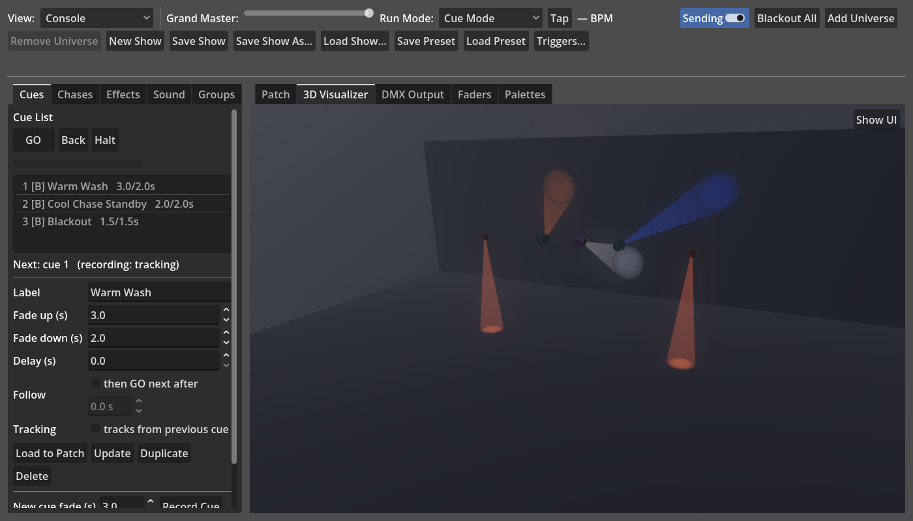

# sLight DMX Lighting Controller

A ready-to-run Godot 4 project with a GUI for controlling DMX lighting
fixtures. Each universe outputs over **Art-Net** or **sACN (E1.31)** —
both plain UDP, no plugin needed — or, with the optional `addons/native`
GDExtension built, straight to a **USB DMX interface** (Enttec, Open DMX,
uDMX). That same extension bundles four more optional features that
speed things up or fill in gaps locally: recording the 3D view to MP4,
decoding and analysing a music file for DJ Edit Mode in C++ instead of
playing it 4× through a capture bus, sending MIDI feedback straight to
a real port instead of through a Python bridge script, and advertising
the OS2L server over mDNS so VirtualDJ finds it on its own. It's one shared
library, built with one command; the app runs fine without it.

New to sLight? See the [**User Guide**](docs/USER_GUIDE.md) for a
step-by-step walkthrough with screenshots. This README is the complete
technical reference.

## What's included

- `project.godot` — project config (Forward+ renderer, for volumetric
  beams; audio input enabled), registers `artnet_sender.gd`,
  `sound_engine.gd`, `tempo_clock.gd` and `effects_engine.gd` as the
  `ArtNet`, `Sound`, `Tempo` and `Fx` autoload singletons.
- `artnet_universe.gd` — the `ArtNetUniverse` class: one universe's
  512-channel buffer plus its own UDP socket and target. `compute_output()`
  folds the effect/chase overrides, virtual dimmers, the live flashes'
  top layer and grand master into `output` (which the 3D view reads); `transmit()` puts that on the wire as an `ArtDMX`
  packet.
- `usb_dmx_bridge.gd` — the `UsbDmx` autoload: optional USB-DMX universe
  output via the `addons/native` GDExtension (FTDI D2XX + libusb
  backends — Open DMX, Enttec Pro, uDMX). A no-op when it isn't built.
- `sacn.gd` — the `Sacn` class: builds E1.31 (streaming ACN) Data packets
  and the universe multicast address. Used by `ArtNetUniverse` when a
  universe's output is set to sACN.
- `artnet_sender.gd` — the `ArtNet` autoload: manages one `ArtNetUniverse`
  per universe slot (up to 8), the grand master, the cue crossfade
  engine, and `tick()` (recompute every universe's output; transmit if
  asked).
- `effects_engine.gd` — the `Fx` autoload: runs the chases, waveform
  effects and (in Sound Reactive mode) sound reactors, and composites
  their combined output into a per-universe override layer.
- `sound_engine.gd` — the `Sound` autoload: captures an audio input,
  exposes smoothed bass / mid / treble / level energy and a beat signal.
- `tempo_clock.gd` — the `Tempo` autoload: the console's tempo clock, set
  by Tap Tempo, an incoming MIDI clock or VirtualDJ's OS2L beats, which
  beat-sync chases step on and tempo-synced effects run at.
- `sound_reactor.gd` / `sound_panel.gd` — the `SoundReactor` class and
  the Sound tab: maps a band or the beat onto a channel role, with a
  live band meter.
- `spectrogram.gd` — a scrolling FFT heat-map for the live input on the
  Sound tab.
- `structure_bar.gd` / `wave_heatmap.gd` — the analysed-song structure
  strip and a whole-song colour-coded waveform (loudness height, spectral
  hue), in DJ Edit Mode's timeline, where the waveform shows part of
  a song and zooms with the mouse wheel. The structure strip is editable:
  drag a section border (snapped to the nearest bar — or beat, or not at
  all: right-click > Snapping) to fix a boundary the analyser placed
  slightly wrong, or right-click a section to relabel, split, or delete
  it. It can be locked against editing and can follow
  a zoomed view too (both used by DJ Edit Mode's timeline).
- `triggers_engine.gd` — the `Triggers` autoload: listens for MIDI
  (Godot's `InputEventMIDI`) and OSC (a UDP listener), fires console
  actions, and sends feedback (LED updates) when a binding's target is
  active.
- `osc.gd` / `trigger.gd` / `triggers_dialog.gd` / `feedback_out.gd` — a
  minimal OSC 1.0 reader/writer, the `Trigger` binding class (match +
  action + feedback), the config dialog with a Learn mode, and the
  outbound MIDI/OSC sender.
- `midi_out_bridge.gd` — the `MidiOut` autoload: native MIDI output
  through the optional `addons/native` GDExtension (RtMidi), for MIDI
  feedback. Godot's built-in MIDI support is input-only; this fills in
  the output half without a separate process. Falls back to
  `tools/midi_bridge.py` (below) when the extension isn't built.
- `tools/midi_bridge.py` — forwards sLight's UDP MIDI-feedback packets to
  a real MIDI port. Only needed when `addons/native` isn't built —
  Godot has no built-in MIDI output of its own.
- `song_analyzer.gd` / `song_detect.gd` / `song_analysis.gd` / `fft.gd` —
  analyses a music file (STFT chroma + timbre, a dynamic-programming beat
  tracker, self-similarity segmentation with verse/chorus repetition
  detection, Krumhansl-Schmuckler musical key detection) into a tempo,
  beat grid, downbeats, labelled sections and a detected key; the
  detection maths, result data class, and a small radix-2 FFT. With
  the `addons/native` GDExtension built, the decode + STFT + onset +
  waveform front-end runs in C++ on a worker thread — and can read M4A /
  AAC through the OS's decoder (Windows, macOS); otherwise the track
  is played 4× through a muted capture bus first.
- `main.tscn` — a single root `Control` node with the GUI script attached.
- `dmx_controller.gd` — the shell: a top bar (view selector, grand
  master, run mode, Sending, add/remove universe, whole-show + preset
  save/load, MIDI/OSC triggers) above either the console — a split view
  of playback tabs (Cues / Chases / Effects / Sound / Groups)
  on the left, one universe tab each on the right — or DJ Edit Mode or
  DJ Perform Mode; plus the shared fixture-profile list and the profile
  new/edit/delete flow.
- `music_browser_panel.gd` — the `MusicBrowserPanel` class: DJ Edit
  Mode (the music library). A narrow tree of this machine's drives and folders
  (loaded as they're expanded) followed by **VirtualDJ Lists** (its Virtual Folders);
  selecting one lists its music on the right — title, artist, BPM, key,
  length, album, genre, file — from VirtualDJ's database where it knows
  the track, sortable by any column, with missing files flagged.
  Double-clicking a track replaces the list with its timeline; selecting
  a folder goes back. A track with saved lighting timelines in the
  current show has a small node-line icon before its title (blue, like a
  dimmer line). Most are told straight from the show's timelines index
  (which records each song's path and size); only a track the same size
  as an indexed song that isn't at its path — it may have been moved —
  is fingerprinted, in the background. The icons update when a song's
  timelines are first saved and when another show is loaded.
  The folders sit under a **Folders** header. Below them, a
  **Positions** header lists the show's named positions for moving
  fixtures, each after a right-facing triangle in its own colour; the
  **+** at the header's right adds one ("Position N", the next colour —
  hues stepped round by the golden ratio, so no two match — selected and
  opened straight away). Picking
  one opens the position editor in place of the track list; its name is
  edited there. Hovering a position shows an **✕** at its right, which
  asks before deleting it; right-clicking one gives **Rename** (opens it
  with the name selected to type over), **Duplicate** (a copy with its
  points, "… copy", the next colour, opened) and **Delete…**. Deleting
  the open position goes back to the track list.
- `position_list.gd` — the `PositionList` class: that list — a row per
  position (triangle, name, hover ✕, right-click) — styled from the theme as a standard list (ItemList): its panel, item
  hover / selected boxes, font colours, size and padding.
- `position_library.gd` — the `PositionLibrary` class: a show's named
  positions — each an id, a name, a colour and a pan / tilt per fixture
  (by fixture uid, normalised 0..1 over each axis' range, tilt
  bottom-up; a fixture without one sits in the centre). Saved with the
  show.
- `position_editor.gd` — the `PositionEditor` class: one position's
  editor. A large pan / tilt pad fills the space, kept square (the cue
  mode XY pad's look, at size); on its right, the position's name —
  editable, after its colour's triangle — over a list of every fixture
  with pan and tilt. Selecting fixtures (Ctrl / Shift for several)
  highlights their points in the position's colour, with their names;
  the others show dimmed. Dragging a highlighted point moves it — and
  every other selected one with it; clicking a dimmed point selects
  that fixture. While selected (and the editor's showing), a fixture is
  lit full white to find it — as the patch's Flash does: dimmer and red /
  green / blue / white full, amber / UV off, a colour wheel open, plus
  its shutter open and its virtual dimmer full — and pointed at the
  position (its pan / tilt at its point, following live as points are
  dragged). Unselecting it, opening another position, or leaving the
  editor (another folder, another view) puts it back exactly as it was,
  pan / tilt included, and a show saved meanwhile keeps its real levels.
  Ctrl+C copies the selected fixtures' points (in list order); Ctrl+V
  pastes them onto the selected fixtures, in this position or another:
  the selected fixtures, in list order, take the copied points in turn,
  starting over when there are more of them (so one point goes to every
  selected fixture). Pasting sets the points in the PositionLibrary, so
  it's saved with the show and the pad and live highlight follow. Not
  while the name field has the focus.
- `timeline_generator.gd` — the `TimelineGenerator` class: the Generate
  button's show, from the song's structure (its sections and their
  energy, rescaled across the song so its quietest part is low and its
  loudest high), its tempo (beat grid, else BPM) and the fixtures' rows.
  The master's dimmer follows the energy section by section (25–100 %,
  a beat's fade between sections, faded in at the start and out at the
  end); fixtures pulse on every beat in the loudest sections — chasing
  across them — and every bar in the upper-middle ones, following the
  master elsewhere. Colours come from a palette per kind of section (every
  chorus alike, shifted per song): the master's main colour, every other
  fixture's accent, a multi-head fixture's heads blending between them,
  the loudest sections sweeping main → accent. A strobe builds (medium,
  then fast) over the two bars before a big rise in energy; the named
  positions take a section each in turn; and the master's movement goes
  from a small slow tilt sweep (quiet) through a circle to a large fast
  figure 8 (loudest) — only over a position (with none named yet,
  Generate adds a "Centre" one, every fixture centred).
- `dj_performer.gd` — the `DjPerformer` class: DJ Perform Mode's engine.
  Runs an `Os2lServer` (subscribed to four decks), follows each deck's
  song, play state, volume fader and position, loads a new song's
  timelines from the show's `TimelineStore` on a worker thread, and
  every refresh mixes the live decks' timelines (`song_output()`, then
  `mix()`: HTP, pan / tilt averaged) into an `ArtNet.layer_providers`
  layer.
- `dj_perform_panel.gd` — the `DjPerformPanel` class: DJ Perform Mode's
  view — the live flash buttons, the OS2L connection and, per deck,
  song, state, position and timelines.
- `live_flash.gd` — the `LiveFlash` class: the live flashes (Blackout,
  Strobe, White, Colour), held or latched, as an `ArtNet.top_providers`
  layer over everything else in the frame.
- `music_timeline.gd` — the `MusicTimeline` class: a track's timeline —
  the zoomable colour waveform along the bottom (a song opens fully
  zoomed out, showing the whole track; mouse wheel zooms,
  Shift+wheel scrolls, and pressing and dragging the middle button
  anywhere over the waveform or the timelines above it pans the view
  with the pointer) above a slim whole-track overview whose rectangle
  marks the visible part: drag it, or click elsewhere to jump. Decoded on
  a worker thread by the native extension (`SongFeatures.waveform_file`,
  100 columns per second), including M4A through the OS's decoder.
  Back-to-start and Play / Pause buttons (or Space) to the right of the
  waveform play the track; a red line, topped by an inverted triangle,
  marks the playback position — click the waveform or the bar strip
  above it to set it, drag to move it (during playback the audio jumps
  there on release); the view pages along as it plays. VirtualDJ's
  beat grid, when it knows the track, is drawn over the waveform — a line
  per beat, bolder at each bar of four, variable-tempo grids included —
  and the strip along its top numbers the bars from 1 (thinned to every
  2nd / 4th / ... bar when zoomed out), with a tick per beat while the
  beats are far enough apart to read. Above that, the song's structure
  (Intro / Verse / Chorus / ..., analysed in the background when the
  track opens, on VirtualDJ's beat grid with section borders snapped to
  its bars), with two small buttons beside it: a padlock to unlock
  editing it (drag a border, right-click a section — locked by default),
  and **Generate**, which builds a light show into the song's timelines
  (`timeline_generator.gd`) — replacing what they had, as one undo step.
  The waveform is 90 px tall.
- `timeline_track.gd` — the `TimelineTrack` class: a lighting timeline
  in the track timeline, for the master (all fixtures), a fixture, or one
  head — a stack of rows for what its target supports, bottom up:
  Position (moving heads), Strobe, Movement (moving heads), Colour (10 px each) and an 80 px
  Dimmer row with a node line, filled white underneath fading from
  transparent at the bottom to 50 % at the top. The master track (every
  row) sits above the song structure and follows the waveform's zoom,
  with the waveform's beat and (bolder) bar lines drawn behind its rows —
  thin and fainter than on the waveform, so they don't compete with the content,
  and the playhead line running down every track (on a layer of its own,
  so it moves without redrawing the rows; drag it with the left button
  to scrub, as on the ruler — a dimmer node under the pointer still wins);
  beside each track, a name plate shows its target's name vertically
  (in a smaller font if that's what fits). The space above the master is
  a vertically scrolling panel with a timeline for every patched fixture
  (rows for its channels), each followed — when it has more than one
  head — by one per head (rows for that head's channels; a darker plate,
  the fixture's name with "Head N" on a second line). They follow the
  patch as it changes, keeping their dimmer nodes; the scroll bar's room
  comes out of the name plates' column, so every track stays as wide as
  the waveform. A fixture's or head's dimmer row starts empty — no line,
  no values — and inherits: a head its fixture's, a fixture the
  master's. Giving it values (the Dimmer submenu, a paste) overrides
  what it inherits, from its line's first node to its last; outside that
  it inherits again, and it's drawn only across that stretch. Edits there
  add no edge nodes beyond the line's ends, and the pulses / Smooth on an
  empty row start and end at the level it inherits. The master's line
  runs the whole song: a song without one starts with a node at its
  start and one at its end, both at 0 % — so nothing comes on until the
  line's raised or a fixture has values of its own (not counted as an
  edit — no undo step, nothing to save until something else changes).
  A fixture or head with colour channels but no DIMMER channel still gets
  a Dimmer row — its virtual dimmer.
  The dimmer line's nodes are edited with the mouse: drag a node to move
  it (in time, kept between its neighbours, and in level, 0–100 %) — hold
  Shift to lock it to the axis the pointer has moved furthest on; drag the
  line itself to move that stretch of it (the nodes either side) up or
  down; Ctrl + left-click on the line to add a node there; Ctrl +
  right-click a node to remove it. With no nodes the dimmer is a flat
  100 %. A song's timelines (every track's nodes, keyed by the fixture's
  uid, and the structure once edited) are saved with the show — see
  `timeline_store.gd`.
  A left-button drag on an empty part of the timelines (not a node or
  the dimmer line) selects an area: on every row the drag crosses —
  rows of several fixtures and the master included — and over whole
  bars, whole beats or exactly the dragged time, as the structure bar's
  Snapping says (with snapping, a click selects the bar or beat under
  it; without, a click clears the selection). A plain drag replaces the
  selection, **Ctrl** adds the new area to it, and **Shift** extends the
  last area through the new one (all the rows and time between). It's
  drawn as a translucent blue over each selected row
  (`timeline_selection.gd`), and cleared when another song opens.
  **Delete** clears what's selected, by kind of row: on a dimmer row the
  nodes inside each selected span go and the level drops to 0 across it,
  with a node at each edge keeping the level just outside as it was (a
  step down at the start, back up at the end; overlapping spans on a row
  are merged first). The selection stays.
  **Ctrl+A** selects everything — every row of every timeline, over the
  whole song — and **Escape** or **Ctrl+D** clears the selection. **Ctrl+C** copies the selected areas (kept when another
  song opens),
  **Ctrl+X** cuts them (copies, then clears them as Delete does) and
  **Ctrl+V** pastes them: at the start of the current selection, into
  the tracks it touches — one copied track goes into each of them, so a
  fixture's dimmer can be copied to several at once; several copied
  tracks pair off in order — or, with nothing selected, at the playhead
  back into the tracks they came from. Each row goes into the same kind
  of row; a dimmer stretch replaces the line there, the level outside
  kept (cut off at the song's end). The pasted areas become the
  selection.
  **Ctrl+Z** undoes timeline edits — dimmer nodes and line, Delete, cut,
  paste, the song structure — and **Ctrl+Y** (or Ctrl+Shift+Z) redoes
  them, up to 100 steps. Each song keeps its own history while the show
  is open (switching songs and back keeps it; loading another show
  clears it); a new edit after undoing drops what could be redone.
  A plain drag on a selected area's **start or end** moves that edge
  (snapped like a new selection: to the nearest bar or beat, or freely),
  and any dimmer node or colour segment boundary sitting on that edge
  moves with it (a segment stretching or shrinking, keeping its colours)
  — kept between its neighbours, and the edge can't pass the other end. A plain drag
  **inside** the selection moves the whole selection (its start snapped,
  kept within the song): while dragging only the selection moves — with
  a ghost of its content (the dimmer line dashed over a faint fill, the
  colour bands paler) where it would land, and the spot it's leaving
  dimmed; on
  release its content is cut from where it was (cleared as Delete does)
  and put down at the new place, overwriting what's there — one undo
  step, and the clipboard's left alone. A click inside the selection
  without dragging is a plain click (selects the bar / beat under it);
  Ctrl / Shift drags still build the selection. A dimmer node takes
  precedence over a selection edge, and an edge over the dimmer line.
  The cursor shows left-right arrows on an edge and a move cursor inside.
  The **Colour** row holds colour segments: a span with a colour at each
  end (one colour for a static colour, two for a gradient), drawn as a
  band; outside its segments the row sets nothing. Delete, cut, copy,
  paste, undo and saving cover it as they do the dimmer.
  **Right-click** a timeline for a menu of what fits there. On the
  selection: Delete, Undo / Redo (when there's something to undo /
  redo), Cut, Copy, Paste (when something's been copied), then — for the
  kinds of row selected — a **Dimmer** submenu (Black 0%, Half 50%, Full
  100%, Fade In 0→100%, Fade Out 100→0%, Pulse In: from the level on the
  left of the selection up to 100% and down to the level on its right,
  Pulse Out: the same down to 0%, Smooth: a straight ramp between the
  two, Pulse on Every Beat / Bar: up to 100% on each and down to 0% by
  the next) and a **Colour** submenu (Static Colour… and Gradient… with
  colour pickers, Rainbow, preset colours, Clear Colour), each applied to
  every selected row of its kind; then Select All / Deselect. Off the
  selection: Undo / Redo, **Paste Here** (at the clicked time, into the
  clicked track) and Select All. Ctrl+right-click on a dimmer node still
  removes it.
  The **Strobe** row holds strobe segments: spans where the strobe's on
  at a speed — Slow, Medium or Fast — (off everywhere else), each drawn
  as a line up the row at either end with a dashed line between: along
  the bottom of the row for slow, the middle for medium, the top for
  fast. Its right-click submenu has **Strobe Slow / Medium / Fast** and
  **Strobe Off** (strobes saved before speeds read as Medium); Delete, cut / copy / paste, moving the selection
  (with its ghost), dragging a selection edge (a strobe's start / end on
  it moves too), undo and saving cover it like the colour row. Touching
  strobe segments of the same speed join into one.
  The **Position** row holds position segments, each naming one of the
  show's named positions: drawn as the position's triangle in its colour
  at the start, with a line in that colour across the span (grey if the
  position's since been deleted). Its right-click **Position** submenu
  lists every named position with its icon, then **Clear Position**;
  Delete, cut / copy / paste, moving (with the ghost), edge drags, undo
  and saving cover it like the strobe row, and touching segments of the
  same position join.
  The **Movement** row (moving heads and the master only) holds movement
  effects, relative to the pan / tilt the Position row gives: **None**
  (hold still — a fixture's None beats a master movement), **Circle**,
  **Figure 8**, **Pan Sweep** and **Tilt Sweep** — each with a size
  (**Small / Medium / Large**: 4 / 8 / 16% of the pan / tilt range) and a
  cycle length (**½ / 1 / 2 bars**, from the beat grid where it's
  applied). Drawn as the effect's shape, tiny (bigger for a bigger
  movement), at the start with a line across the span (dashed for
  None). Its right-click **Movement** submenu has the effects, then
  **Size** and **Cycle** radio items — checked at the selection's
  movement; picking one changes the selected movements (effects kept)
  and is what new ones get — and **Clear Movement**; Delete,
  cut / copy / paste, moving, edge drags, undo and saving cover it like
  the other rows.
- `timeline_store.gd` — the `TimelineStore` class: a show's music
  timelines, in a folder beside the show file (`MyShow.slight` →
  `MyShow.timelines/`): one JSON file per song, named by the song's
  fingerprint (its size and a hash of its first and last 64 KB, so a
  moved or renamed song keeps its timelines), plus an `index.json` of the
  songs (each one's path, title and size). Each holds the song's tracks (`master`, `<fixture uid>`,
  `<fixture uid>/h<n>`: their dimmer nodes) and its edited structure.
  The timeline saves the open song's into it when the song is left —
  another song opened, the timeline hidden, the app closed — and on Save
  Show. A removed fixture's timeline is kept, and shows again if the
  fixture comes back.
- `universe_panel.gd` — the `UniversePanel` class: one universe's tab —
  its connection settings, blackout/full, and fixture patch with
  purpose-built per-fixture controls.
- `xy_pad.gd` — the `XYPad` control: the draggable pan / tilt trackpad
  used for moving-head fixtures in the patch.
- `cue.gd` — the `Cue` class: a stored look (every universe's non-zero
  channels) plus split fade-in / fade-out times, a delay and an
  optional follow; captures from and renders back to the live buffers.
- `cue_list_panel.gd` — the `CueListPanel` class: an ordered cue list
  with GO / Back / Halt, record / update / delete, delays and
  auto-follows, and a progress bar for what's running.
- `chase.gd` / `chase_list_panel.gd` — the `Chase` class and its tab: a
  tempo-cycled list of captured steps with crossfade and direction, and
  an optional beat-sync (steps on each beat of the tempo clock, or of
  the audio in Sound Reactive mode).
- `wave_effect.gd` / `effects_panel.gd` — the `WaveEffect` class and its
  tab: a waveform on one channel role, fanned across the fixtures, in
  Absolute or Pickup (base-value) mode, at its own rate or following the
  tempo clock.
- `groups_panel.gd` — the Groups tab: named sets of patched fixtures
  (by fixture uid) an effect can target instead of a whole universe.
- `fixture_import.gd` — the `FixtureImport` class: reads GDTF (`.gdtf`
  ZIP, including its `<Geometries>` tree + glTF models) and Open Fixture
  Library (`.json`) definitions into `FixtureProfile` — best-effort role
  mapping + physical hints, with a warnings list.
- `mvr_io.gd` — the `MvrIO` class: My Virtual Rig (`.mvr`) import (reads
  each `<Fixture>`'s matrix, address and bundled GDTF) and export
  (writes a scene description + a generated GDTF per profile).
- `dmx_render.gd` — the `DmxRender` class: turns a fixture's slice of a
  universe's `output` into a visual state (colour, dimmer, pan/tilt,
  zoom, strobe, gobo, gobo spin) for the 3D view. A `COLOR_WHEEL`
  channel resolves to a real colour (explicit hex, a colour parsed from
  its slot label, or "open/white"), and a fixture is correctly read as
  lit from its wheel/shutter alone even with no separate `DIMMER`
  channel — the shape of most colour-wheel scanners.
- `fixture_view.gd` — the `FixtureView` class: one fixture in 3D — the
  GDTF geometry (glTF models + pan/tilt axes) when it has one, otherwise
  a schematic body by category, driving a `SpotLight3D` + beam cone.
- `visualizer_panel.gd` — the `VisualizerPanel` class: the 3D Visualizer
  tab — SubViewport world with volumetric fog, orbit camera + saved
  views, rooms, trusses, glTF props, placement, screenshot, MP4 / PNG
  recorder, MVR import/export, and a "Dock to Main" button (the shell
  reparents the panel into its own window when its tab is dragged off).
- `video_rec.gd` — the `VideoRec` class: records the visualizer to an
  `.mp4` (H.264 + an MP3 audio track) through the optional `addons/native`
  GDExtension, or a silent PNG sequence + `ffmpeg` line when it isn't
  built. The audio track mixes whatever's actually audible: an
  `AudioEffectCapture` on the Master bus (DJ Edit Mode's music) plus `Sound`'s
  own mic/line-in tap (deliberately muted out of Master so it doesn't
  feed back through speakers, hence its own capture).
- `addons/native/` — one optional GDExtension (C++) bundling USB DMX
  output (FTDI D2XX + libusb), the MP4 encoder (minih264 + minimp4 +
  shine for the audio track), the song decode + analysis front-end
  (minimp3 + stb_vorbis, plus the OS's AAC decoder for M4A), native MIDI
  output (RtMidi), and DNS-SD service
  advertising through the OS's own mDNS responder — one shared
  library so an exported build only ships a single GDExtension. Has one
  `build.py` and `BUILD.md`; ships disabled so
  an unbuilt checkout is quiet.
- `fixture_profile.gd` — the `FixtureProfile` class: one or more DMX
  *modes*, each an ordered channel list. Every channel has a role
  (`DIMMER`, `RED`, `PAN`, ...) plus a default/home value, min/max
  limits, a 16-bit `fine` flag, and optional named value ranges. Ships a
  handful of built-in profiles (including a multi-mode moving head) and
  JSON (de)serialization that still reads the old single-list format.
- `fixture_library.gd` — the `Library` autoload: the fixture library.
  A small always-resident catalogue over ~640 bundled fixtures (from Open
  Fixture Library, `res://fixtures/`) with search / filter; full
  `FixtureProfile`s load on demand from per-manufacturer shards.
  `refresh_online()` also pulls the live OFL list from GitHub, and
  `refresh_gdtf()` the live GDTF-Share catalogue (after `gdtf_login()` —
  session-only credentials, never persisted); both download/cache
  individual fixtures under `user://fixture_online/`.
  `tools/build_fixture_library.gd` regenerates the bundle from an OFL checkout.
- `virtualdj_database.gd` — the `VirtualDjDatabase` class: reads
  VirtualDJ's `database.xml` song databases (the one in
  `Documents/VirtualDJ/` plus `<drive>:/VirtualDJ/` on every drive),
  merged by file path — tags, VirtualDJ's BPM / key / beat-phase
  analysis (including the variable-tempo `BeatGrid` it stores for long
  mixes, expanded to per-beat times by `beat_times()`, with `bpm_at()`
  giving the tempo VirtualDJ's deck reports at any point), hot cues,
  automix points and named remix sections. Not yet wired into the UI.
- `virtualdj_list.gd` — the `VirtualDjList` class: reads VirtualDJ's
  playlists — the `.vdjfolder` Virtual Folders in the `MyLists`
  directory next to each `database.xml` — in VirtualDJ's display order,
  with `resolve()` matching each track to its `VirtualDjDatabase` entry.
- `os2l_server.gd` — the `Os2lServer` node: an OS2L (Open Sound to Light)
  TCP server that DJ software connects to — `beat` / `btn` / `cmd`
  events as signals, `feedback` back, and VirtualDJ's `subscribe`
  extension for live per-deck values (track, BPM, beat position, play
  state, ...). Advertised over mDNS (`_os2l._tcp`) when `addons/native`
  is built, so VirtualDJ finds it on its own; otherwise VirtualDJ's
  `os2lDirectIp` option has to point at it. Not yet wired into the UI;
  `tools/os2l_monitor.gd` runs one headless and prints what arrives.
- `autosave.gd` — the `Autosave` class: a snapshot of the show every
  minute while it has unsaved changes, and the session marker that tells
  the next start the app didn't close properly, so it can offer the
  snapshot back.
- `recent_dirs.gd` — the `RecentDirs` class: every file dialog (Load Song,
  Import fixture, Load glTF model, Import/Export MVR) reopens in the
  folder it was last used in, remembered per dialog rather than as one
  shared directory, persisted to `user://recent_dirs.json`.

## Universes

The window is a tab per Art-Net universe. **Add Universe** (also
**Ctrl+Shift+N**) / **Remove Universe** in the top bar manage the list
(1–8 universes). Remove Universe (also **Ctrl+Shift+R**) removes the
selected universe after asking, saying how many fixtures go with it.
Each tab has
its own IP, port, and Art-Net universe number (several tabs may target
the same number on different IPs), its own fixture patch, and its own
512-channel buffer. New universes are numbered to the first free Art-Net
number.

Each tab's **Output** selector routes that universe to **Art-Net** (the
IP / port / universe number), **sACN** (E1.31 — multicast by default,
with a priority and an optional unicast IP), or a **USB DMX** interface
(pick a device + interface type, **Rescan**, **Apply Connection**). USB
needs the `native` GDExtension built (`addons/native/BUILD.md`); until
then it's greyed out. See
[Output: Art-Net, sACN, or USB DMX](#output-art-net-sacn-or-usb-dmx).

Global controls live in the top bar:

- **View** — switches the area below the top bar between the
  **Console** (everything described here), **DJ Edit Mode** — a tree of
  drives and folders plus **VirtualDJ Lists** (its Virtual Folders), the music in
  whichever is selected (details from VirtualDJ's database; click a
  column title to sort), and a song's lighting timelines to edit (while
  the song plays they go live — the lights and 3D view follow the
  playhead, edits included, as DJ Perform Mode would play them; paused,
  the look at the playhead holds — following it as it's moved — while DJ
  Edit Mode is showing, and the console has the rig back in the other
  views) — and
  **DJ Perform Mode**, where VirtualDJ plays those timelines (below). The
  console keeps running underneath either; the spacebar GO only works in
  the Console.
- **DJ Perform Mode** — while it's showing, sLight listens for VirtualDJ
  over OS2L (advertised on the network as "sLight", port 9960; or point
  VirtualDJ's `os2lDirectIp` at this machine) and plays the lighting
  timelines of the songs on its decks into the lights. The panel shows
  the connection and, for each of up to four decks, the song, whether
  it's playing, its position and its timelines' state. When a deck gets
  a new song, its timelines (from DJ Edit Mode, in the show's timelines
  folder) load in the background, so nothing stalls. A deck drives the
  lights while it's playing with its volume fader up — a deck being
  cued in the headphones with its fader down doesn't — following
  VirtualDJ's position (reported every 100 ms, run on smoothly between
  reports, at the deck's pitched speed). Decks playing together are
  mixed per channel: colour, dimmer and strobe (and anything else)
  highest-takes-precedence, pan / tilt averaged. A song's dimmer comes
  from a head's line where it has values, else its fixture's, else the
  master's — each overriding, not scaling, the one above: on a fixture
  with a DIMMER channel that channel is set (to its brightest head's
  level where heads have lines of their own, each head's colour then
  scaled to its own level); on one without, its colour is scaled, like
  its virtual dimmer. A colour segment sets a
  head's red / green / blue — the head's own colour row first, else its
  fixture's, else the master's — and otherwise the console's colour
  stands. Only what a song's timelines cover is driven; everything else
  stays as the console has it. The timelines go into the frame under
  chases and effects. Leaving DJ Perform Mode stops
  the OS2L listener and the timeline playback (the live flashes, below,
  keep working from MIDI / OSC pads in any view). Where a fixture's strobe
  row, or the master's, is on, its STROBE channel goes to a strobing
  value for the speed (the faster of the two) — a fifth of the way up a
  range labelled strobe / pulse for slow, just over half way for
  medium, its fast end for fast; without such a range, the same through
  20–240 — and is otherwise left as the console has it. Where a
  fixture's position row (else the master's) names a position, its PAN
  and TILT go to that position's point for the fixture — 16-bit across
  coarse and fine channels, else over the channel's min–max — and decks
  moving the same fixture are averaged. Where a fixture's movement row
  (else the master's) has an effect, its pan / tilt trace that shape
  around the position — or, without one, around the console's pan /
  tilt — in time with the song (the effect's cycle from the segment's
  start); None holds it still.

- **Grand Master** — one 0–255 fader that scales *every* universe's
  output on send (non-destructive: the per-channel values you dialed
  aren't lost when you pull it down and back up).
- **Sending** — toggles the ~30 Hz refresh stream for all universes.
- **Blackout All** — zeroes every universe.
- **Save Show / Save Show As… / Load Show…** — the whole show in one
  JSON file (`.slight`) you pick: every universe's connection settings
  and fixture patch (each fixture's profile — embedded, so the file is
  portable — address, mode, and position / rotation in the visualizer),
  the fixtures' live levels and virtual dimmer settings, the cue list,
  chases, effects, fixture groups, named positions, sound reactions,
  triggers, run mode and the visualizer's stage. Each fixture has a permanent uid,
  saved with it. The music tracks' lighting timelines go in a folder
  beside the show (`<show>.timelines/`, named in the show file), keyed by
  those uids: Save Show also saves the open song's unsaved timelines,
  Save Show As… copies the folder alongside the new file, and Load Show…
  switches to that show's folder. **Save Show** writes to the
  current show file (the last saved or loaded; `user://dmx_show.json`
  until you pick one; also **Ctrl+S**, from either view), **Save Show
  As…** picks a new one (also **Shift+Ctrl+S**) and **Load Show…** opens
  one (also **Ctrl+O**). The current show file is remembered
  (`user://last_show.json`) and reopened when the app next starts; if
  it's been moved or won't load, the app starts empty and the status
  line says why. Files are tagged with a format version: one from a
  newer sLight, or a file that isn't a show, is refused and the current
  show left alone. Older show files (without live levels or fixture
  uids — new ones are made) still load, as
  does a legacy single-universe patch file (a bare fixtures array), as
  universe 1.
- **New Show** (also **Ctrl+N**) — after asking, starts an empty show: one
  universe with no fixtures, everything dark, no cues, chases, effects,
  groups, sound reactions or triggers, the visualizer's stage
  reset and no music timelines (the open song's are saved first).
  Universe 1's output settings (IP / port / sACN / USB) are kept, as
  they belong to this machine rather than the show. The new show is
  untitled: **Save Show** asks where to save it, and until it's saved the
  last saved show is still the one reopened at start.
- **Autosave** — every minute, if the show has changed since it was last
  saved, loaded or autosaved, a snapshot of it goes to
  `user://autosave.slight` (never over the show file itself), and the
  open song's unsaved timeline edits are saved to its show's timelines
  folder, as leaving DJ Edit Mode does. `user://session.json` marks the
  app as running from start to a clean quit, when the snapshot is
  removed. If sLight crashes, is killed or loses power, the next start
  finds the session still marked and — when the snapshot holds anything
  the reopened show doesn't — asks whether to **Restore** it (as it was
  autosaved, for the same show file, not saved yet: **Save Show** keeps
  it) or **Discard** it.
- **Save/Load Preset** — one `user://dmx_preset.json` with every
  universe's live DMX buffer (non-zero channels only). A legacy flat
  `{channel: value}` preset still loads, into universe 1. A preset wider
  than the current show adds the missing universes.

## Playback: cues, chases, effects, sound, groups

The left-hand side is a set of playback tabs. They composite on top of
the base output that the fixture controls write: **cues** *replace* the
base as they crossfade in; **chases** and **effects** run as a live
**override layer** on top (highest-takes-precedence between them), so a
chase or effect can run over a standing cue and stops cleanly without
disturbing it. **Groups** are just fixture selections that effects and
reactors use.

### Run modes

The **Run Mode** dropdown in the top bar switches how the console is
driven:

- **Cue Mode** (default) — the cue list owns playback; the spacebar
  fires GO. Chases and effects layer on top as above.
- **Sound Reactive** — an audio input is monitored and its energy drives
  the **Sound** tab's reactors (and any beat-synced chases) as an
  override layer, on top of whatever base look is standing. Cues still
  hold their last look as that base; the spacebar is disabled.
The mode is saved in the show file. (Shows saved in the old Auto Show
run mode open in Cue Mode — songs' light shows are now built and played
in DJ Edit Mode / DJ Perform Mode.)

### Live flashes

Across the top of DJ Perform Mode, **Live:** has four flash buttons for
reacting to the music over whatever's playing — the console, the songs'
timelines, chases and effects all sit underneath them. Each works while
it's held down: its button, its key (**B**, **S**, **W**, **C**, in DJ
Perform Mode), or a MIDI / OSC pad bound to its *Flash* trigger action
(in any view). Tick **Latch** to make them stay on when clicked, until
clicked again; unticking Latch lets go of them all.

- **Blackout** — every patched fixture's intensity to 0: its DIMMER
  channel and its colour / white channels. Pan, tilt, gobos and the rest
  are left alone, so movers stay where they're pointing.
- **Strobe** — every fixture at full, strobing: a STROBE channel goes to
  the fast end of its strobe range (as a timeline's fast strobe does),
  and a fixture without one is flashed in software (10 Hz, a third of
  each cycle lit). On its own it strobes the colours already playing.
- **White** — full white: DIMMER, red, green, blue and white full, amber
  and UV off; a fixture with a colour wheel and no RGB turns it to its
  nearest (whitest) slot.
- **Colour** — full in the colour picked in the swatch beside it: DIMMER
  full, red / green / blue from the colour, white / amber / UV off; a
  colour wheel to its nearest slot.

Strobe combines with White or Colour (a white or coloured strobe); White
beats Colour; Blackout beats everything. Under White or Colour without
Strobe, a STROBE channel is set to its *Open* value so a timeline's
strobing doesn't carry into the flash. The flashes go into the frame
after the fixtures' virtual dimmers — so a fixture its virtual dimmer
has taken down still flashes — and under the grand master. The colour
and Latch are saved with the show; the flashes themselves always start
off.

### Tempo clock

Beside the run mode, **Tap** and the read-out after it (`128.0 BPM · Tap`,
or `— BPM` while it's off) are the console's **tempo clock**, which runs
in any run mode and view. Beat-synced chases step on its beats and
effects set to **Follow tempo** run at its tempo. Its tempo comes from:

- **Tap Tempo** — click **Tap**, press **T**, or bind a pad to the *Tap
  tempo* trigger action, on the beat. Each tap lands a beat; two or more
  less than 2 seconds apart set the tempo from their average spacing
  (the last 8 taps). Pause longer to start a new count.
- **MIDI clock** — any MIDI input sending a timing clock (24 pulses per
  beat: DJ software, a drum machine, a DAW). It takes the clock over
  after a beat's worth of pulses, its tempo averaged over the last four
  beats; a MIDI Start makes the next pulse beat 1.
- **VirtualDJ** — in DJ Perform Mode, the beats VirtualDJ sends over
  OS2L, with its deck's tempo.

While MIDI clock or VirtualDJ is arriving it owns the clock and taps are
ignored. When it stops, the clock runs on at the last tempo until it's
tapped again, or stopped with the **✕** after the read-out. The
read-out flashes on each beat, and a feedback pad set to *Beat pulse*
follows the clock's beats while it's running. The tempo isn't saved with
the show.

### Sound tab

Pick an **Input** device (system default, or any capture device — hit
**Rescan** after plugging one in). The **bass / mid / treble / level**
meter flashes on each detected beat, and below it a scrolling
**spectrogram** shows the input's frequency content over the last few
seconds. **Gain** trims the incoming signal, **Beat sensitivity** sets
how much louder than the rolling average a transient must be to count as
a beat, and **Response** trades meter smoothness for snap.

A **reactor** maps one band (or `Level`) onto a channel role across the
patched fixtures that carry it — same target rules as an effect
(universe filter or a fixture group). Its output swings between **Low**
and **High** DMX values as the band moves from silent to full, shaped by
**Attack / Release** (rise / fall speed) and spread along the fixture
list by **Fan**. Two modes:

- **Follow** — output tracks the band continuously (bass → dimmer swell,
  treble → a colour channel shimmer).
- **Pulse** — every beat snaps the output to **High**, then it releases
  (a beat-driven strobe or colour hit).

Arm reactors with **Run**; they only drive output while the run mode is
Sound Reactive. In the **Chases** tab, **Beat sync** makes a chase step
once per beat instead of on its BPM: the tempo clock's beats while it's
running (in any run mode), otherwise the beats detected here in Sound
Reactive mode.

### MIDI / OSC triggers & feedback

**Triggers…** in the top bar opens the binding editor. Each **binding**
maps one incoming message to one console action:

- **Source** — **MIDI** (a Note, Control Change or Program Change, on a
  chosen channel or *Any*) or **OSC** (an address like `/cue/go`). Turn
  **MIDI input** / **OSC input** on at the top; OSC listens on a UDP port
  you set (default 9000).
- **Learn** — click it, then play the pad / move the fader / send the OSC
  message, and the match fields fill in from what arrived.
- **Action** — *Cue GO / Back / Halt / Go to #*, *Chase toggle*,
  *Effect toggle*, *Blackout all*, *Tap tempo*, or one of the live
  flashes — *Flash — Blackout / Strobe / White / Colour* — held while
  the pad is: a note until its note-off, a CC until it drops below 64,
  OSC until a message whose first argument is `0`. A Program Change,
  which has no release, turns its flash on and the next one off. Go-to takes a cue number; the
  chase / effect toggles take a name (or a 1-based index), with a picker
  populated from what's programmed.

A note fires on note-on; a CC fires when its value crosses 64 (so a
momentary button works, a slider mostly won't); an OSC message fires
unless its first argument is `0` (so TouchOSC's press-then-release
buttons only trigger on press). The bottom of the dialog shows the last
message received.

**Feedback (LEDs).** Tick **Feedback (LEDs)** at the top, then on any
binding tick **light this pad** and pick what it **follows** with an
**on** / **off** value (a velocity, or a pad colour code for RGB grids):

- *this binding's action* — the pad lights while its cue is live / its
  chase or effect is running / its flash is on (needs a Go-to-# /
  toggle / flash action).
- *Beat pulse* — a flash on every beat: the tempo clock's while it's
  running, else the audio's (Sound Reactive).
- *Sending is on*, *Any chase / effect running*,
  *Run mode: Cue / Sound Reactive* — standalone console-state
  indicators. Set the **Action** to *(nothing — feedback only)* for a pad
  that's only an indicator.

Pads clear when their state ends and all are cleared on exit. OSC
feedback goes straight to the device (`OSC →` host / port). Godot has no
built-in MIDI *output*, so MIDI feedback needs one of two paths:

- With the optional `addons/native` GDExtension built (see
  `addons/native/BUILD.md` — no separate runtime driver to install,
  unlike USB DMX), the Feedback row shows a **MIDI output** port picker —
  pick a real MIDI port straight from the list and **Rescan** after
  plugging something in. No extra process to run.
- Without it, MIDI feedback falls back to UDP, sent to a small bridge
  script — run `python tools/midi_bridge.py --port "<your controller>"`
  (needs `pip install mido python-rtmidi`) and point **MIDI → bridge :**
  at the same port (default 9010).

Bindings and all of the MIDI / OSC / feedback settings are saved in the
show file.

### Cue list

An ordered list of **cues**, each a stored look plus fade timing.
Stepping through them crossfades the whole rig.

- **Record Cue** captures the current live output of *every* universe as
  a new cue (inserted after the selected one, or at the end). So dial a
  look with the fixture controls, set **New cue fade**, and record.
- **GO** (or the **spacebar**) fires the next cue: every universe
  crossfades from whatever it's outputting now to that cue's **standing
  look** (see tracking, below). Channels rising use the cue's *fade up*
  time, channels falling use *fade down*; a channel that doesn't change
  doesn't move.
- **Back** fades to the previous cue; **Halt** freezes a running fade
  where it is, and stops a delay or follow that's waiting.
- **Delay (s)** holds a cue's fade back that long after its GO. The cue
  is live (marked `>`) at once; the previous cue's fade runs on through
  the delay.
- **Follow** — *then GO next after* — makes a cue GO the next one by
  itself once its own fade finishes and the wait set beside it (0 for
  straight away) has passed. Chain follows to play a run of cues as a
  sequence: it carries on until a cue without Follow (or the end of the
  list). Pressing GO, Back or a MIDI / OSC Go-to while a delay or follow
  is waiting takes over from it; Halt and Blackout All cancel it.
- The **bar under the transport** shows what's running: a delay counting
  down (`Delay 1.2s`), then the fade's progress (`Cue 3  40%  1.8s` —
  over the longer of the fade times its moves use), then a follow's wait
  (`Follow in 2.0s`). The list marks a cue's delay as `d1.5` and a follow
  as `→ 2.0s`.
- Select a cue to edit its **label**, **fade up / down** seconds, delay,
  follow and **Tracking** flag inline. **Update** overwrites the selected cue with
  the current live output; **Duplicate** and **Delete** do what they say.
- **Load to Patch** sets every fixture control to the selected cue's
  standing look — colour pickers, sliders, gobo dropdowns and all — so
  you can tweak it and press **Update** to re-record. (This is the one
  place the fixture controls follow the buffer rather than just writing
  to it.)
- Cues (and which one is live) are saved inside the show file.

**Tracking.** With the **Tracking** box (by Record Cue) ticked, a new cue
stores only the channels it *changes* from the look the earlier cues
leave standing — including a channel it drives to 0. Every other channel
**tracks** through untouched, and editing an upstream cue ripples down
the list. Untick **Tracking** on a selected cue to make it a **block**:
it stores a full look and stops the ripple there. Playback always folds
cues 1..n together (blocks wipe first, tracking cues merge on top), so
GO's fade target is the complete standing look for that point in the
list. The cue list shows `[T]` / `[B]` per cue. Toggling a cue's flag
rewrites its stored levels so its on-stage look doesn't change — only how
it reacts to edits before it. Older show files load their cues as blocks,
so they play back exactly as before.

While a fade is running it owns the output — moving a fixture control
mid-fade is overwritten until the fade lands. **Blackout All**, loading a
preset, or loading a show cancels any running fade.

### Chases

A **chase** is an ordered list of **steps** (captured looks, like cues)
cycled at a tempo.

- **New Chase**, then dial a look and **Record Step**; repeat.
- **Load Step to Patch** sets the fixture controls to the selected step,
  **Update Step** overwrites it from the current live output — the same
  edit loop as cues. **Delete Step** removes it.
- **Tempo (BPM)** sets the step rate; **Crossfade (%)** is how much of
  each step is spent fading in from the previous one (0 = hard snap);
  **Direction** is forward / backward / bounce.
- **Run** starts it. Several chases can run at once.

### Effects

An **effect** is a waveform on one channel **role**, applied across a set
of patched fixtures that carry it.

- **Role** (Dimmer, Red/Green/Blue, White, Amber, UV, Pan, Tilt) picks
  which channel. **Universe** (all, or one) or **Group** (see below)
  picks which fixtures — the target channels are read from the live
  patch, so press **Rebuild targets from patch** after re-patching.
- **Base**: *Absolute* swings around **Center**; *Pickup* swings around
  each channel's **live value** — the level the fixture control or the
  running cue is holding — so the effect adds movement on top of the
  programmed look instead of replacing it, and follows it as it changes.
- **Waveform**: sine, triangle, sawtooth, square, or random.
- **Rate (BPM)**, **Size** (peak-to-peak swing), **Fan (deg)** spreads
  the phase across the fixture list (a chase-across-the-rig), **Phase
  (deg)** offsets the whole effect — run a Pan and a Tilt sine 90° apart
  for a circle. A **Pan / Tilt / Zoom** effect's rate is capped at 60 BPM
  — the motors can't chase a faster waveform — so switching an effect to
  one of those roles pulls its rate down if needed.
- **Follow tempo**: *Own rate* (the default) runs at the Rate; *½ beat*
  to *8 beats* runs one cycle every that many beats of the tempo clock
  while it's running — and keeps it in phase with them, so a dimmer pulse
  peaks on the beat — falling back to the Rate when it's off. A Pan /
  Tilt / Zoom effect is still capped at 60 cycles a minute.
- **Run** starts it.

### Groups

The **Groups** tab holds named sets of patched fixtures. Pick one in an
effect's **Group** box to run the effect on just those fixtures (in
patch order, which sets the fan sequence) instead of a whole universe.
Tick fixtures in/out with the checklist; **Sync to patch** refreshes it
after you add or remove fixtures. A group remembers its fixtures by their
permanent uid, so it keeps the same fixtures however the patch is
reordered, and across saving and loading the show (older shows, which
saved members by patch position, are converted on load). Removing a
universe takes its fixtures out of every group.

Chases, effects and groups are saved inside the show file. **Blackout
All**, loading a preset, or loading a show stops every chase and effect.

## Fixture profiles

Instead of only controlling raw DMX channels, you can patch **fixtures**:
a profile (what kind of light it is) plus a start channel (where it sits
in that universe).

**Built-in profiles**: Dimmer (1ch), RGB (3ch), RGBW (4ch), RGBAW (5ch),
a 7-channel Moving Head RGBW Pan/Tilt, and a multi-mode Moving Head Spot
(8ch and 14ch/16-bit personalities showing off fine channels, value
slots, and defaults). Real fixtures vary a lot in channel order — always
check the fixture's own DMX chart before relying on one of these for a
physical light; the moving-head profiles in particular are just
illustrative starting points.

Each channel in a profile carries more than a role:

- **default** — the home value the fixture snaps to when first patched
  and whenever you click its **Home** button.
- **min / max** — clamp limits, so a channel's control can't leave its
  usable range.
- **fine** — marks a channel as the 16-bit LSB partner of the channel
  right before it (Pan + Pan Fine, Tilt + Tilt Fine, Dimmer + Dimmer
  Fine, ...).
- **ranges** — named value slots for wheels (gobo, colour), e.g.
  `0-9 Open, 10-19 Red, 20-29 Orange`, each with an optional swatch
  colour or (from a GDTF import) an embedded picture.

Channel roles include `DIMMER`, `RED`/`GREEN`/`BLUE`/`WHITE`/`AMBER`/`UV`,
`PAN`(`_FINE`), `TILT`(`_FINE`), `ZOOM`, `STROBE`, `GOBO`, `GOBO_ROT`,
`COLOR_WHEEL` and `GENERIC`. A profile also carries a **physical** block
(category, beam angle, pan/tilt range, and per-head offset **and
rotation** for multi-head fixtures) and, from a geometry-rich GDTF, a
`geometry` tree (glTF models + pan/tilt axes) — both for the 3D
visualizer, filled from a GDTF/OFL import or guessed from the roles. GDTF
geometry Position matrices are read in full (rotation + translation) and
converted from GDTF's Z-up frame to Godot's Y-up. Repeated RGB triplets in a
mode's channel list are treated as separate heads: GDTF
`<GeometryReference>` blocks are expanded into the flat channel list, and
OFL `matrix` / `matrixChannels` template channels are instanced per
pixel.

Profiles can also have **multiple modes** (personalities) — the same
fixture as an 8-channel and a 14-channel layout, say. Pick the mode in
the **Mode** dropdown when patching.

**Patching a fixture**: in the "Fixture Patch" row, pick a profile and
mode, optionally name it, set its start channel, and click **Add
Fixture**. Its panel appears below with the right controls automatically:
- A complete Red/Green/Blue trio becomes one colour picker. A fixture
  with several triplets (a multi-head batten or pixel bar) gets one
  picker per head, labelled **Colour 1**, **Colour 2**, …
- A channel + its fine partner become one high-resolution (0–65535)
  slider that splits across the two DMX channels on output.
- A **Pan** and a **Tilt** channel together become one 2D pad — drag the
  puck to aim the head, pan on the horizontal axis, tilt on the vertical
  (up = higher value). The mouse wheel nudges the puck one snapped step
  for fine work (vertical wheel = tilt, **Shift**+wheel = pan). 16-bit
  pan/tilt is split across its channels the same way. The readout under
  the pad shows the raw values.
- A channel with named ranges becomes a slot dropdown plus a trim slider
  (they stay in sync — moving the slider re-selects the slot it lands in).
  Each item carries a little icon: an imported picture if the slot has
  one (e.g. gobo art from a GDTF), otherwise a colour swatch for a
  `COLOR_WHEEL` channel (from an explicit colour, or guessed from the
  slot name) or a schematic pattern for a `GOBO` channel (open ring,
  dots, spokes, bars, rings, cross, breakup — by slot position). The
  collapsed dropdown shows the current slot's icon.
- Every other channel gets its own small slider, clamped to min/max.
- A fixture with colour/white channels but **no DIMMER channel of its
  own** also gets a **virtual dimmer**: a per-fixture intensity master
  that scales its Red/Green/Blue/White/Amber/UV output on the way to the
  wire, so you can fade the fixture without disturbing the colour you
  set. It's applied when the universe builds each DMX frame
  (`ArtNetUniverse.compute_output`, after effect / chase overrides and
  before the grand master), so the colour channels keep holding the
  actual colour — the fixture controls, cues, presets and Load to Patch
  all see the undimmed values; only the frame on the wire (and the 3D
  view, which reads it) is dimmed. A fixture with a real DIMMER channel
  has no virtual dimmer, and its colour channels output the colour as
  set. It homes to full (so a homed fixture acts like one whose real
  dimmer is open), and opens fully when a look is loaded.
- **Flash** (hold) drives that fixture to full white — dimmer and every
  R/G/B/W channel to full for each head, a colour wheel to its open slot
  — and snaps the affected channels back to exactly what they were on
  release. **Home** resets every control in that fixture to its channel
  defaults; **Remove** deletes it.

**Library...** browses a fixture library with three sources:

- **Bundled** — ~640 real fixtures converted from the
  [Open Fixture Library](https://open-fixture-library.org) project
  (`res://fixtures/`, regenerated by `tools/build_fixture_library.gd`; see
  `fixtures/ATTRIBUTION.md`). Search by manufacturer or model, filter by
  type / channel count / pan-tilt, preview modes and channel layout. Only
  the small catalogue index is in memory; a definition loads on demand.
- **OFL online** — pulls the *current* OFL fixture list straight from
  GitHub (one request) and downloads a fixture when you open it, so you're
  not limited to the bundled snapshot. Downloads are cached under
  `user://fixture_online/` and work offline afterwards; **Clear cache**
  empties it.
- **GDTF-Share** — the same idea against [GDTF-Share](https://gdtf-share.com),
  the official GDTF repository. It needs a free GDTF-Share account:
  switching to this source prompts for a username/password, which are used
  only to obtain a session cookie and then **never written to disk** —
  both are held in memory for the running session only, so you log in
  again next launch. Downloaded fixtures are cached the same way as OFL's
  (under `user://fixture_online/`, its own **Clear cache**).

**Add to Patch** resolves the profile, drops it into the picker for the
current session and selects it — it travels inside the show file when you
save, so there's no copy in `user://fixture_profiles/` unless you
**Edit...** it.

**New...** opens a dialog where you name the
profile, add one or more modes, and add channels one at a time. Each
channel row has a label, a role dropdown, `d` / `min` / `max` spinners, a
`16-bit` checkbox, and a free-text ranges field — `lo-hi:label:colour`
per slot, e.g. `0-9:Open:#fff, 10-19:Red:#c00` (the colour is optional;
`GOBO` slots draw a pattern from their position). Saving writes a JSON
file to `user://fixture_profiles/` and adds it to every universe's
profile picker immediately — no restart needed.

**Edit...** opens the same dialog pre-filled with the selected profile.
Its id and file stay put, so the edit sticks across restarts; editing a
built-in writes an editable copy that shadows it. Editing a profile does
*not* retroactively change fixtures already patched from it — re-patch
those to pick up the changes.

**Delete...** asks for confirmation, then removes the profile's JSON
file. Deleting an edited built-in resets it to its code default; a
pristine built-in can't be deleted.

**Import...** reads an external fixture definition and adds it as a
custom profile:

- **GDTF** — a `.gdtf` file (a ZIP holding `description.xml`) from
  [gdtf-share.com](https://gdtf-share.com) or a manufacturer. All DMX
  modes are imported; `Offset` pairs become 16-bit channels; wheel slots
  become named ranges with swatch colours (CIE `x,y,Y` → sRGB). If the
  archive carries gobo artwork (`wheels/<MediaFileName>.png`), each
  picture is downscaled and embedded in the profile, and shows in that
  channel's dropdown in place of the drawn pattern.
- **Open Fixture Library** — a single-fixture `.json` from the
  "Download as JSON" button on
  [open-fixture-library.org](https://open-fixture-library.org) (or a raw
  file from its GitHub). Capability types and `fineChannelAliases` drive
  the role mapping; wheel slots supply names and colours.

Mapping is best-effort — anything that doesn't map to a known role is
left `GENERIC`, undefined DMX slots become `GENERIC` placeholders, and
the status line reports how many approximations were made (details go to
the Godot log). Open the result with **Edit...** to check and adjust it.

Pan and Tilt channels default to the middle of their range (so a patched
moving head parks centre stage) unless the GDTF or OFL definition gives
an explicit default.

Custom profiles are shared across every universe tab and persist in
`user://fixture_profiles/`. The fixture list itself is saved as part of
the whole-show file (see **Save/Load Show** above), including each
fixture's full profile definition, so a show is portable even if a custom
profile file is later deleted. Older single-mode profile JSON still loads
— a bare channel list is read as one "Default" mode.

There's no raw per-channel slider list — all control happens through
patched fixtures. The fixture controls write to the buffer rather than
reading back from it, so loading a preset updates the live output but
won't move the sliders/pickers. The cue list's **Load to Patch** is the
exception — it pulls the controls to a stored look so you can edit it.

## 3D Visualizer

The right side has a **3D Visualizer** tab: a dark room with the patched
fixtures, lit live by each universe's composited output — so cues,
chases, effects and the grand master all show, and it keeps updating even
while **Sending** is off. **Hide UI** (top-right corner) collapses all
the on-screen controls for an unobstructed view.

- **Camera**: left-drag empty space to orbit, middle-drag (or Shift +
  left-drag) to pan, wheel to zoom. The **View** dropdown holds saved
  camera views — five presets (Orbit / Front / Audience / FOH high /
  Top) plus your own: **Save as...** adds one, **Update** overwrites the
  selected one, **Delete** removes it. **FOV** and an **Ortho** toggle
  (the Top preset uses it) sit alongside.
- **Placement**: click a fixture to select it, then drag it across the
  floor or type its X / Y / Z and heading / tilt in the panel.
  **Auto-arrange** re-hangs everything in a grid. **Add Truss** drops a
  bar you can move and resize; **Load Model...** brings in a `.glb` /
  `.gltf` as a set piece (move / scale / delete). Fixture positions live
  in the universe patch; camera views, room, haze, shadows, trusses and
  props are the show file's `viz` block.
- **Look**: **Haze** drives Forward+ volumetric fog (real beams in the
  air) plus a faint additive cone; **Room** presets (Black Box / Club /
  Arena) resize the space; **Shadows** turns on per-fixture spot shadows;
  **Work light** is a dim fill so you can see the rig with the beams
  down. Bloom is on for bright beams.
- **Multi-head fixtures**: a profile with more than one RGB triplet
  (a pixel bar, a multi-eye batten, a spider) is drawn as one light
  source per head, each with its own colour, level, position **and
  aim**. Head offset and rotation come from the imported definition —
  GDTF `<GeometryReference>` matrices or the geometries the RGB channels
  drive, or an OFL `matrix` pixel grid — so a spider's beams fan out the
  way the fixture does. A horizontal spread with no rotation is used when
  the file gives none. The patch list shows one colour picker per head
  (**Colour 1**, **Colour 2**, …).
- **What each fixture shows**: colour (RGB/W/A/UV additive, or a
  colour-wheel slot's swatch), intensity (its dimmer, or the brightest
  colour channel), pan/tilt (16-bit aware, through the profile's range),
  zoom (a `ZOOM` channel widens the beam), strobe (shutter channel →
  flicker rate), gobo (an imported GDTF gobo is *projected* through the
  spot) and gobo spin (a `GOBO_ROT` channel rolls the projection). When
  the profile came from a GDTF with `<Geometries>` + glTF models, the
  real body and pan/tilt axes are used, each geometry placed by its full
  Position matrix (rotation included, GDTF Z-up → Godot Y-up); otherwise
  a schematic body picked from the `physical` category.
- **Render**: **Screenshot** saves a PNG. **Record** writes an `.mp4`
  (H.264 + an MP3 audio track) straight from the viewport via the
  optional `native` GDExtension (minih264 + minimp4 + shine — no
  FFmpeg); without it built, Record falls back to a silent PNG sequence
  + an `assemble.txt` ffmpeg line. The audio track is whatever's actually
  audible — DJ Edit Mode's music plus the mic/line-in — mixed live while
  recording; there's no audio in the PNG fallback. Both land in
  `user://render/` and open the folder when done. See
  `addons/native/BUILD.md`.
- **Pop out**: drag the **3D Visualizer** tab off the tab bar and it
  tears into its own OS window — put it on a second monitor for
  front-of-house while the console stays on the main screen. To dock it
  again, drag the window's title back over the tab bar (it lights up),
  press **Dock to Main** in its toolbar, or just close the window.
  Whether it's floating and where the window sits are saved with the show.
- **MVR**: **Import MVR...** reads a `.mvr` — patches every `<Fixture>`
  at its address with its bundled GDTF and drops its trusses in. **Export
  MVR...** writes the current rig back out (a scene description plus a
  generated GDTF per profile), so it can move to Vectorworks, a console,
  Capture, Depence, etc. Both are best-effort against the spec.

## Running it

1. Open the folder in Godot 4.4+ (`Project > Import`, point at
   `project.godot`). The project uses the **Forward+** renderer for the
   3D visualizer's volumetric beams, so it wants a Vulkan-capable GPU.
2. Press Play (F5). The main scene builds its own UI at runtime.
3. On the **Universe 1** tab, pick an **Output** (Art-Net / sACN / USB
   DMX), set its target — for Art-Net the **IP / Port / universe**
   (default `127.0.0.1:6454`, universe 0) — and click **Apply
   Connection**. Add more universe tabs from the top bar as needed.
4. Move any fixture control — it's sent to that universe's target roughly
   30 times a second while **Sending** is checked, matching how real DMX
   gear expects a continuous refresh stream rather than one-off packets.
5. Dial a look, click **Record Cue**, repeat for a few looks, then step
   the show with **GO** (or the spacebar). The **Chases** and **Effects**
   tabs add tempo-cycled steps and waveform effects that run on top.

The window is freely resizable (down to 720×480). Toolbars, the
connection/patch rows, and each fixture's bank of sliders are laid out in
wrapping rows, so controls that don't fit the current width flow onto the
next line instead of running off the right edge; the fixture list scrolls
vertically only. Each playback tab (Cues / Chases / Effects / Sound /
Groups) grows a vertical scrollbar when the window is too short to show
all of its controls, so nothing becomes unreachable.

### Testing without real hardware

You don't need physical lighting to try this out:

- **QLC+** (free, open source) can receive Art-Net and show live DMX
  values / drive a virtual console — good for confirming packets arrive
  correctly before connecting real fixtures.
- Any Art-Net monitor/sniffer will show the same.

### Going to real fixtures

Point the IP at an Art-Net-to-DMX gateway/node (e.g. an ENTTEC ODE,
a DIY ESP32 Art-Net node, or a lighting desk's Art-Net input) on your
network, set the matching universe, and the gateway converts the Ethernet
packets to a physical DMX512 signal for your fixtures.

## Output: Art-Net, sACN, or USB DMX

A universe's **Output** selector (connection row) chooses where its frames
go. **Art-Net** is the default.

**sACN** (ANSI E1.31) is the standardised DMX-over-Ethernet protocol —
built in, no extension. It **multicasts** to `239.255.<hi>.<lo>` on UDP
5568 (a receiver just subscribes to the universe's group), or unicasts if
you fill in an IP. Set the E1.31 **priority** (0–200, default 100) in the
sACN row. The source CID is generated once and saved with the show so
receivers see one stable source. Works with QLC+, most consoles, ETC
gear, DMXKing/Enttec sACN nodes, etc.

**USB DMX** streams straight to a USB interface through the optional
`addons/native` GDExtension — no gateway, no network. Two backends:

- **FTDI D2XX** — **Enttec DMX USB Pro** / Mk2, **DMXKing ultraDMX** and
  other "pro" boxes (a framed message, the interface's MCU does the DMX
  timing — reliable), and **Enttec Open DMX USB** (bare FT232 — the
  extension generates the BREAK / MAB and streams raw 250 k 8N2; USB
  latency makes it jittery, fine for LED pars, marginal for movers).
- **libusb** — **anyma uDMX** (one vendor control transfer per frame;
  EP0 is slow so it refreshes at ~20–25 Hz), and **raw FTDI** (the FT232
  vendor requests + a bulk write — Open DMX / Enttec Pro without the D2XX
  driver, single-port FT232R/BM/FT-X, listed only when D2XX is absent).

Devices from whichever backends are installed show in one list; pick
**Auto** to let it guess the interface type, or force one. Build it once
with `python addons/native/build.py` (needs SCons + a C++ toolchain;
clones `godot-cpp`). The backend library (`ftd2xx` and/or `libusb-1.0`)
must be present on the machine that *runs* the app — both are loaded
dynamically. Details in `addons/native/BUILD.md`. The `UsbDmx` autoload
no-ops cleanly when the extension isn't built. The chosen output (device
serial + interface type) is saved in the show file; loading a USB show
on a machine without the extension falls back to Art-Net.

## Extending it

- **More USB backends**: `addons/native` has FTDI D2XX and libusb (uDMX +
  raw FTDI). A `libftdi`-style path for multi-port FT2232/FT4232 or an
  FT232H clock scheme would slot in behind the same `UsbDmxOutput`.
- **sACN input / discovery**: output is done (`sacn.gd`); receiving E1.31
  or Art-Net (to act as a node) would be the mirror image.
- **Fixture profiles**: already implemented — `FixtureProfile` carries
  per-mode channel lists with roles, defaults, min/max, 16-bit fine
  pairs, named value ranges with swatch/gobo icons, and physical hints;
  the GUI generates purpose-built controls per fixture (including a
  virtual dimmer); GDTF / Open Fixture Library definitions can be imported
  (with GDTF gobo artwork), and **Library...** browses ~640 fixtures
  bundled from OFL (searchable, lazy-loaded, `tools/build_fixture_library.gd`
  regenerates them), the current OFL list fetched live from GitHub, or the
  current GDTF-Share catalogue (needs a free account; session-only login,
  never written to disk) — all cached to `user://` once downloaded. Room
  to grow: gobo artwork in the bundle.
- **Playback**: cues do split-time crossfades and **track** (a cue stores
  only what it changes; blocks stop the ripple); chases cycle captured
  steps at a tempo or on the beat; effects run waveforms (absolute or
  base-value pickup) on a role across a universe or a fixture group;
  MIDI / OSC bindings fire cue / chase / effect actions with a Learn
  mode and light the controller's pads back — mirroring the action, or a
  standalone beat / sending / run-mode indicator (MIDI feedback native via
  the optional `addons/native` GDExtension, or a small UDP bridge script
  without it; OSC feedback direct). Cues have delays and auto-follows,
  with a progress bar for what's running. Room to grow: per-channel
  track flags in the cue editor.
- **Run modes**: **Cue Mode** (cue list drives playback), **Sound
  Reactive** (an audio input drives band → role reactors and beat-synced
  chases over the standing base look). Songs' light shows live in DJ
  Edit Mode's timelines and play in DJ Perform Mode. A tempo clock (Tap
  Tempo, MIDI clock, VirtualDJ's OS2L beats) drives beat-sync chases and
  tempo-synced effects. Room to grow: Ableton Link sync (its SDK is
  GPL-licensed, so not bundled), sending MIDI clock out.
- **3D visualizer**: already implemented — a Forward+ SubViewport with
  volumetric beams + real gobo projectors + bloom, GDTF geometry / glTF
  fixture models, glTF set-piece props, spot shadows, saved camera views,
  an in-app **H.264 + MP3 MP4 recorder** (the `addons/native` GDExtension —
  minih264 + minimp4 + shine; silent PNG-sequence fallback), multi-head
  fixtures (one light per RGB triplet, with offset and aim from the
  definition file's geometry matrices), **tear-off into its own OS
  window**, and MVR import/export, all driven by the live output. Room to
  grow: prism / animation wheels, a deterministic offline render of a
  song's timelines, an MVR round-trip that survives every consumer.

## License

MIT — see [LICENSE](LICENSE). The bundled fixture data under
`fixtures/` is converted from the
[Open Fixture Library](https://open-fixture-library.org) project and
ships under its own license — see `fixtures/OFL-LICENSE.txt` and
`fixtures/ATTRIBUTION.md`.
