# sLight User Guide

A step-by-step walkthrough for a new user, from opening the app for the
first time to running a show. For a complete technical reference of every
feature, see the [README](../README.md) — this guide focuses on the
essential workflow, in order, with screenshots.

## What you need

sLight controls real (or simulated) DMX lighting fixtures. You don't need
any hardware to follow this guide — see
[Testing without real hardware](../README.md#testing-without-real-hardware)
in the README for a free way to watch the DMX output live (QLC+ or an
Art-Net monitor). When you're ready to control real lights, see
[Going to real fixtures](../README.md#going-to-real-fixtures).

Launch the sLight application — there's no separate setup step, no
account, and no configuration file to edit first. The whole window
you'll see below is what opens.

## The window, at a glance

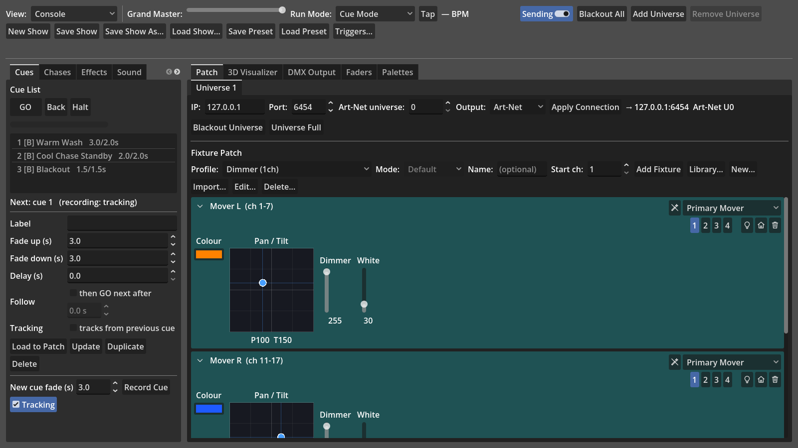

The window is split into three areas:

- **Top bar** — the **View** selector (**Console**, **DJ Edit Mode**,
  **DJ Perform Mode**), Grand Master fader, the **Run Mode** selector,
  **Sending** toggle, Add/Remove Universe, New/Save/Load Show and Preset,
  and **Triggers…** for MIDI/OSC. These are always visible, whatever tab
  or view you're on.
- **Left side — playback tabs**: **Cues**, **Chases**, **Effects**,
  **Sound**, **Groups**. This is where you build and run a show.
- **Right side — Patch / 3D Visualizer**: one tab per universe for
  patching fixtures and dialing them in by hand, and a 3D view of your rig
  lit live by whatever the console is currently outputting.

That split is the **Console** view. The top bar's **View** selector swaps
it for **DJ Edit Mode** — where you build a light show for each song in
your music library — or **DJ Perform Mode**, where VirtualDJ plays those
shows live (Steps 10 and 11). The console keeps running underneath
either one.

Everything below walks through these in the order you'd normally use them
for the first time.

## Step 1 — Add a universe and connect it

Each **Universe** tab (right side) is one 512-channel DMX universe. A
fresh project starts with **Universe 1**. Pick an **Output** — Art-Net is
the default and needs no extra hardware or plugins — set the target (for
Art-Net, the IP/Port/universe number; `127.0.0.1:6454` universe `0` talks
to a monitor running on the same machine), and click **Apply Connection**.
Add more universes from **Add Universe** in the top bar (or
**Ctrl+Shift+N**) if your rig needs more than 512 channels; **Remove
Universe** (**Ctrl+Shift+R**) asks first, telling you how many fixtures
go with it.

## Step 2 — Patch your first fixture

"Patching" tells sLight what kind of light is plugged in where. In the
**Fixture Patch** row, pick a **Profile** (a description of the fixture's
DMX channels) and, if it has more than one, a **Mode**. Set the **Start
ch:** to where it sits in the universe, optionally give it a **Name**, and
click **Add Fixture**. Its control panel appears right below — a colour
picker, a pan/tilt pad for moving heads, sliders for everything else (see
the screenshot above).

A handful of generic profiles (Dimmer, RGB, RGBW, a moving head) ship
built in, but real fixtures vary a lot — click **Library…** to search
~640 real fixtures converted from the
[Open Fixture Library](https://open-fixture-library.org):

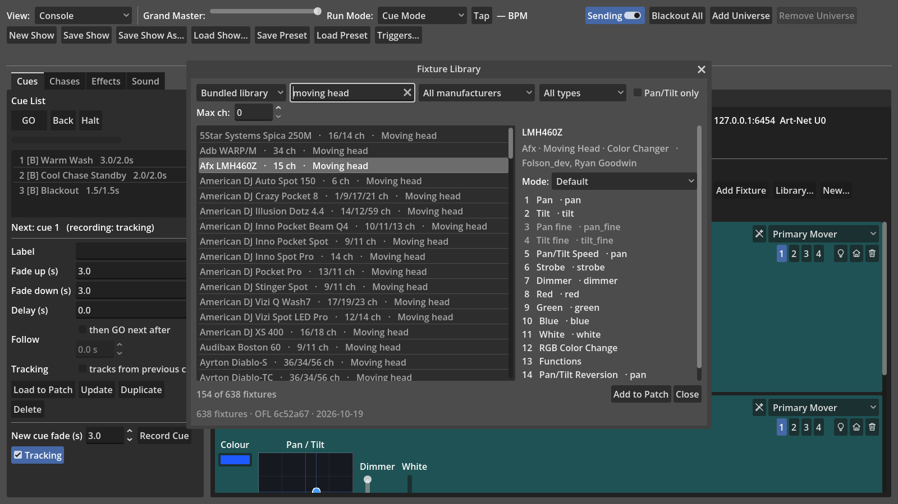

Search by manufacturer or model, filter by type/channel count/pan-tilt,
preview a fixture's modes and channel layout, then **Add to Patch**. If
you have a GDTF or Open Fixture Library file for something not in the
bundle, **Import…** reads it directly.

## Step 3 — Control a fixture by hand

Every patched fixture gets purpose-built controls (visible in the
screenshot for Step 2):

- A full Red/Green/Blue trio becomes one **colour picker**.
- A **Pan** + **Tilt** pair becomes a 2D pad — drag the puck to aim the
  head.
- Everything else gets its own slider, clamped to its usable range.

**Flash** (hold) snaps that fixture to full white and restores it exactly
on release — handy for finding a fixture in a dark room. **Home** resets
every control to its default. Fixture controls send live DMX output
immediately (roughly 30 times a second, while **Sending** is on) — there's
no separate "apply" step.

## Step 4 — Record your first cues

Once you've dialed in a look you like, switch to the **Cues** tab and
click **Record Cue** — it captures the current output of every universe
as a new cue. Repeat for a few different looks, then step through them
with **GO** (or just press the spacebar) — the whole rig crossfades to
the next cue's look over its fade time.

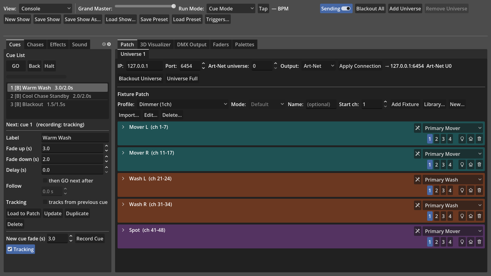

Select a cue to edit its **label** and **fade up/down** times inline.
**Load to Patch** pulls a cue's stored look back into the fixture
controls so you can tweak it and **Update** to re-record. See the
README's [Cue list](../README.md#cue-list) section for the tracking vs.
block distinction, which matters once you're editing a list of cues that
build on each other.

## Step 5 — Add movement with a chase

A **chase** is a list of captured steps that cycle automatically at a
tempo — good for a repeating colour or position pattern that would be
tedious to step through by hand. On the **Chases** tab, click **New
Chase**, dial a look, click **Record Step**, and repeat for each step in
the pattern.

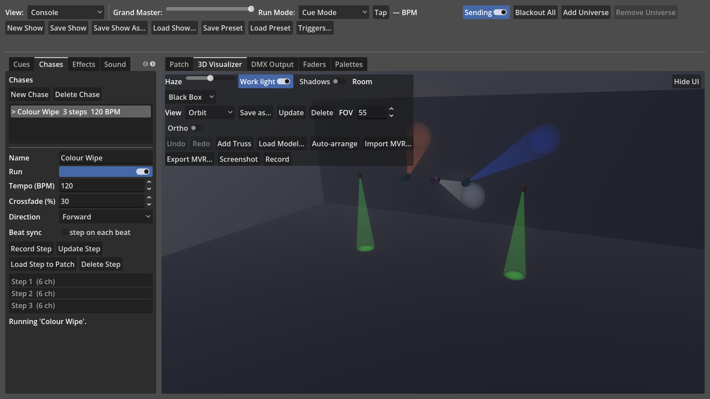

Set the **Tempo (BPM)**, how much each step **Crossfade**s in from the
last one, and a **Direction** (forward / backward / bounce). Click **Run**
to start it — a chase runs as a layer *on top of* whatever your cues are
doing, so it doesn't disturb your programmed look, and stops cleanly when
you turn it off.

## Step 6 — Layer in an effect

An **effect** is a smooth waveform (sine, triangle, sawtooth, square, or
random) applied continuously to one channel role — a breathing dimmer, a
Pan/Tilt circle, a slow colour swell — without needing to record any
steps.

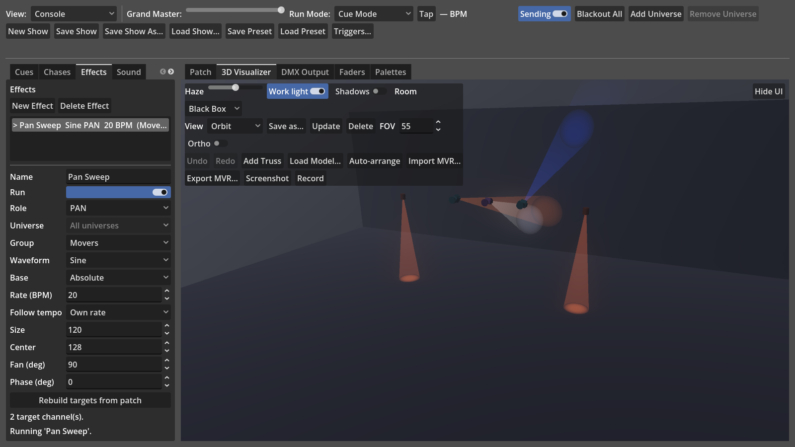

Pick the **Role** it drives and which fixtures (a **Universe**, or a
**Group** — see Step 8), a **Waveform**, **Rate (BPM)**, and **Size**
(how far it swings). **Fan (deg)** spreads the phase across the fixture
list, so instead of every fixture moving in lockstep you get a chase-like
ripple across the rig — try it with two Pan/Tilt effects 90° out of phase
for a circle. Click **Run** to start it; like chases, effects layer over
your cues without disturbing them.

## Step 7 — React to music live

The top bar's **Run Mode** has two settings: **Cue Mode** (the default —
the cue list drives playback) and **Sound Reactive**. Set it to **Sound
Reactive** and switch to the
**Sound** tab to drive output straight from a microphone or line input.

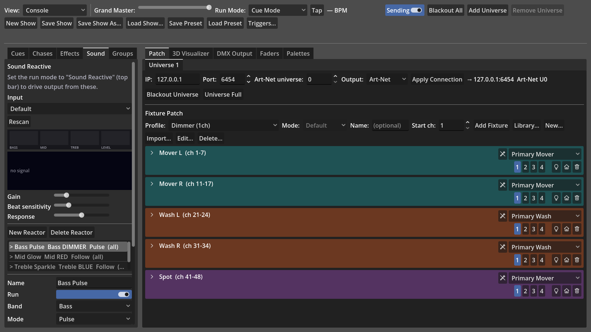

Pick an **Input** device, and a live **bass / mid / treble / level**
meter with a spectrogram shows what's coming in. A **reactor** maps one
band (or the beat) onto a channel role — **Follow** mode tracks the band
continuously (bass into a dimmer swell), **Pulse** mode snaps to full on
every detected beat and releases (a beat-synced flash). A starter set of
four reactors is already here to try — **Bass Pulse**, **Mid Glow**,
**Treble Sparkle**, and **Beat Strobe** (off by default, since it's a lot
more intense than the others) — edit or delete them, or add your own with
**New Reactor**. Tick **Run** on the ones you want active.

## Step 8 — Organize fixtures into groups

The **Groups** tab holds named sets of patched fixtures, so an effect or
reactor can target just "the movers" or "the front truss" instead of a
whole universe.

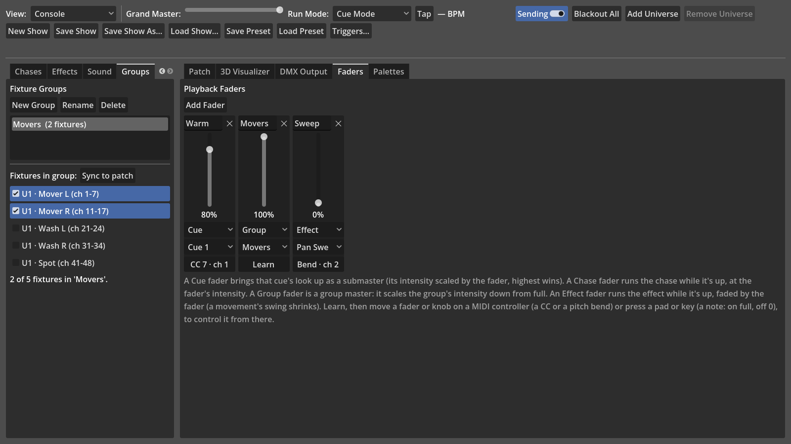

**New Group**, then tick which patched fixtures belong to it. Pick that
group's name in an effect's or reactor's **Group** field instead of a
universe filter. **Sync to patch** refreshes the checklist after you add
or remove fixtures.

## Step 9 — See it in 3D

The **3D Visualizer** tab (right side, next to Patch) shows your rig lit
live by whatever the console is currently outputting — cues, chases,
effects, and the grand master all show, updating continuously.

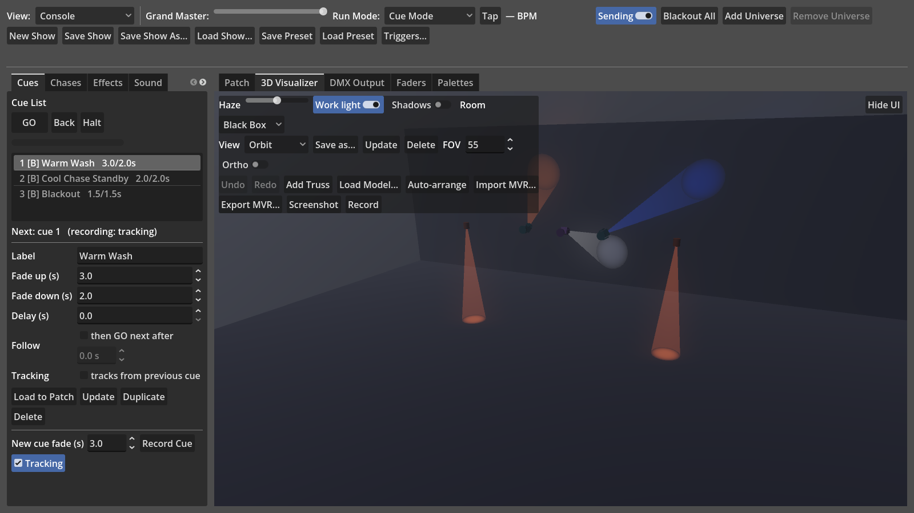

Left-drag empty space to orbit the camera, wheel to zoom. **Auto-arrange**
hangs every patched fixture in a tidy grid to start from; drag a fixture
on the floor (or type exact X/Y/Z and heading/tilt) to place it precisely.
**Add Truss** and **Load Model…** bring in rigging and set pieces. **Haze**
adds real volumetric fog so beams show up in the air; **Room** switches
between a few preset spaces. **Screenshot** and **Record** save a still or
an MP4 straight from this view. Drag the **3D Visualizer** tab off the tab
bar to pop it into its own window — handy for a second monitor at
front-of-house.

## Step 10 — Build a light show for a song (DJ Edit Mode)

Switch the **View** to **DJ Edit Mode** to program lighting against
individual songs rather than cue by cue.

**Find a song.** On the left is a tree of this computer's drives and
folders, followed by **VirtualDJ Lists** (your VirtualDJ Virtual
Folders). Select one and its music is listed on the right — title,
artist, BPM, key, length, album, genre — with details from VirtualDJ's
database where it knows the track. Click a column title to sort. Songs
that already have a light show in the current show are marked with a
small blue node-line icon before the title. M4A / AAC songs open on
Windows and macOS.

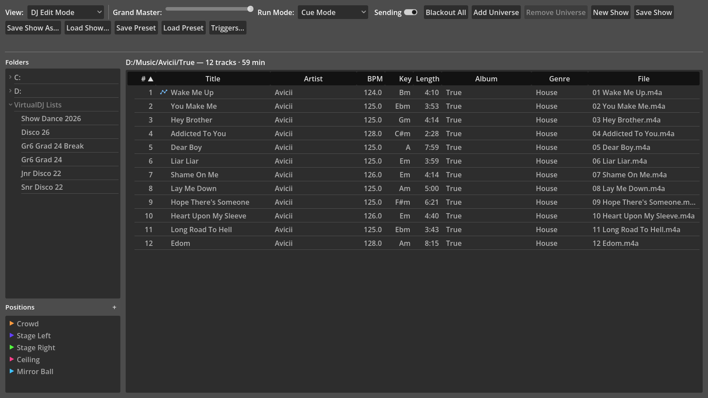

**Open its timeline.** Double-click a song. The list is replaced by its
timeline (select a folder to go back). It opens fully zoomed out:

- Along the bottom is a colour waveform of the song, with VirtualDJ's
  beat grid drawn behind it and the bars numbered along the top. The
  mouse wheel zooms, **Shift**+wheel scrolls, and dragging with the
  middle mouse button pans. The slim overview beneath shows the whole
  song — drag its rectangle, or click to jump.
- **Play / Pause** (or **Space**) and **Back to start** sit to the right.
  The red playhead runs down every timeline; click or drag it on the
  waveform, the bar ruler or any timeline to move it.
- Above the waveform is the song's **structure** — Intro, Verse, Chorus
  and so on — worked out in the background when the song opens. It's
  locked by default; click the padlock to fix a section border the
  analyser put slightly wrong (drag it), or right-click a section to
  relabel, split or delete it. Right-click > **Snapping** chooses
  whether borders and selections snap to bars, beats or nothing.
- Above the structure is the **master** timeline, which drives every
  fixture, and above that a scrolling timeline for each patched fixture
  (and each head of a multi-head fixture).

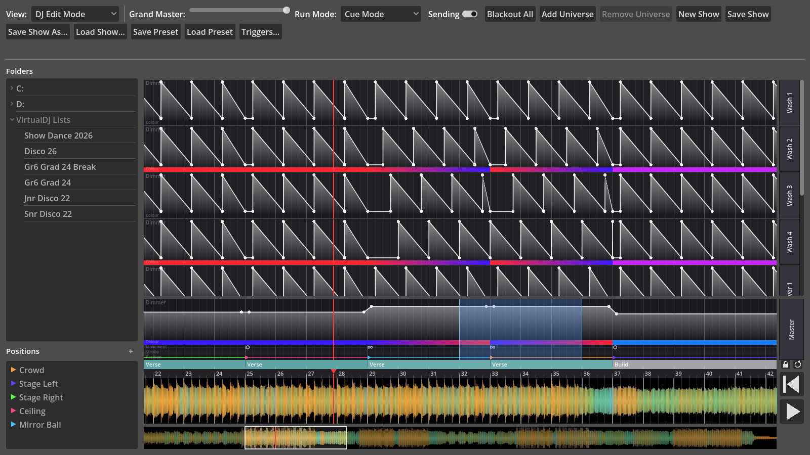

While the song plays, the lights and the 3D Visualizer follow the
playhead exactly as they will in a live show — edits included. When
it's paused, the look at the playhead holds, so you can scrub through
and see each moment.

**Let sLight start it for you.** Click **Generate** (beside the
padlock) to build a complete show from the song's structure and
energy: the master's dimmer follows the music section by section,
fixtures pulse on the beat in the loudest parts, colours change with
each kind of section, a strobe builds before big rises in energy, and
moving heads travel between your named positions with movement that
grows with the energy. It replaces what the timelines had, as a single
undo step — a good starting point to edit by hand.

**Each timeline has rows** for what its fixture can do:

- **Dimmer** — a line of nodes. Drag a node to move it (hold **Shift**
  to lock it to one axis), drag the line to raise or lower a stretch,
  **Ctrl**+click the line to add a node and **Ctrl**+right-click a node
  to remove it. The master's line starts at 0%, so nothing lights until
  you raise it. A fixture's (or head's) dimmer row starts empty and
  follows the master; give it values and it overrides the master over
  that stretch.
- **Colour** — segments of one static colour or a two-colour gradient.
- **Strobe** — stretches where the strobe runs at Slow, Medium or Fast.
- **Position** (moving heads) — which named position the heads point at
  (see *Named positions* below).
- **Movement** (moving heads) — a Circle, Figure 8, Pan Sweep or Tilt
  Sweep around that position, Small / Medium / Large, cycling every ½, 1
  or 2 bars — or None to hold still.

**Select, then edit.** Drag across empty parts of the timelines to
select an area — over every row the drag crosses, snapped to bars or
beats. **Ctrl**-drag adds another area, **Shift**-drag extends the last
one. **Right-click** the selection for a menu of what fits: Dimmer
shapes (Black, Half, Full, Fade In / Out, Pulse In / Out, Smooth, Pulse
on Every Beat / Bar), Colour (Static Colour…, Gradient…, Rainbow,
presets), Strobe speeds, Position, Movement (with Size and Cycle), and
Clear for each. Drag a selection's start or end to resize it (what sits
on that edge moves with it), or drag its inside to move its content
elsewhere — a ghost shows where it will land.

| Keys | Does |
| --- | --- |
| **Delete** | Clear the selected areas |
| **Ctrl+C / Ctrl+X / Ctrl+V** | Copy / cut / paste — into every selected fixture at once, or at the playhead with nothing selected |
| **Ctrl+Z / Ctrl+Y** | Undo / redo (each song keeps its own history, up to 100 steps) |
| **Ctrl+A** | Select everything |
| **Escape** or **Ctrl+D** | Clear the selection |

A song's timelines are saved automatically when you leave it — open
another song, switch view, or close the app — and with **Save Show**.
They're stored with the show (see *Saving your work*), keyed so a song
that's been moved or renamed keeps its light show.

### Named positions

Moving heads point at **named positions** rather than raw pan/tilt
values. In DJ Edit Mode's left-hand tree, below the folders, the
**Positions** header lists them; click its **+** to add one. It opens in
the **position editor**: a large pan/tilt pad beside a list of every
moving fixture. Select fixtures in the list (**Ctrl** / **Shift** for
several) and their points light up on the pad in the position's colour —
drag one to aim them all. While selected, those fixtures are lit full
white and pointed live at the position, so you can see exactly where
they land in the room; they go back to how they were when you leave.
Rename the position at the top of the editor, and right-click one in
the list to **Rename**, **Duplicate** or **Delete** it.

To reuse aim points, select fixtures and press **Ctrl+C** to copy their
points, then select fixtures — in the same position or another one —
and press **Ctrl+V** to paste. The selected fixtures take the copied
points in list order, one each, starting again from the first if
you've selected more fixtures than you copied; so copying one fixture
and pasting onto several aims them all at the same spot. (While you're
typing in the name field, Ctrl+C / Ctrl+V copy and paste its text
instead.)

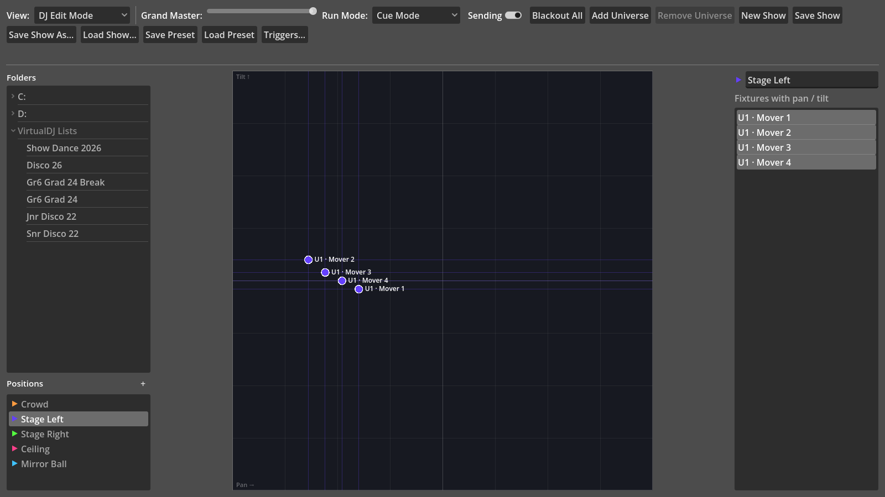

Use them in a timeline's Position row (right-click > **Position**), or
let **Generate** spread them across the song's sections.

## Step 11 — Play it live with VirtualDJ (DJ Perform Mode)

Switch the **View** to **DJ Perform Mode** and sLight starts listening
for VirtualDJ over OS2L. It's advertised on the network as "sLight"
(port 9960), so VirtualDJ normally finds it on its own; otherwise point
VirtualDJ's `os2lDirectIp` setting at this computer. The panel shows the
connection and, for each of up to four decks, the song loaded, whether
it's playing, its position and whether its timelines have loaded.

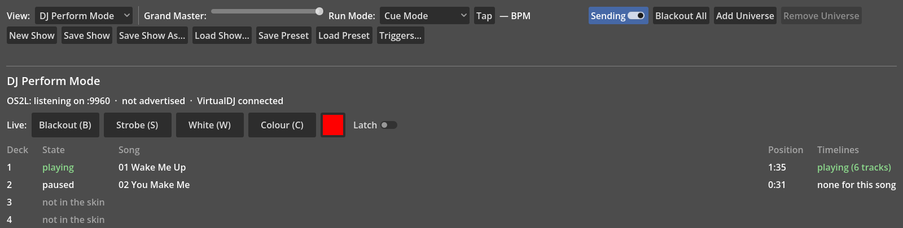

Whenever a deck loads a song, its light show from DJ Edit Mode loads in
the background. A deck drives the lights while it's **playing with its
volume fader up** — a track you're cueing in your headphones with the
fader down stays dark — following VirtualDJ's position and pitch. When
two decks play together during a mix, their shows blend: brightest
wins for colour, dimmer and strobe, and pan/tilt are averaged.

Only what a song's timelines cover is driven; everything else stays as
the console has it, and chases and effects still layer on top. Leaving
DJ Perform Mode stops the listener and the playback.

## Optional: MIDI and OSC control surfaces

**Triggers…** in the top bar (works from any tab) opens the binding
editor, so a MIDI controller or an OSC app like TouchOSC can fire cues,
toggle chases/effects, or trigger a blackout.

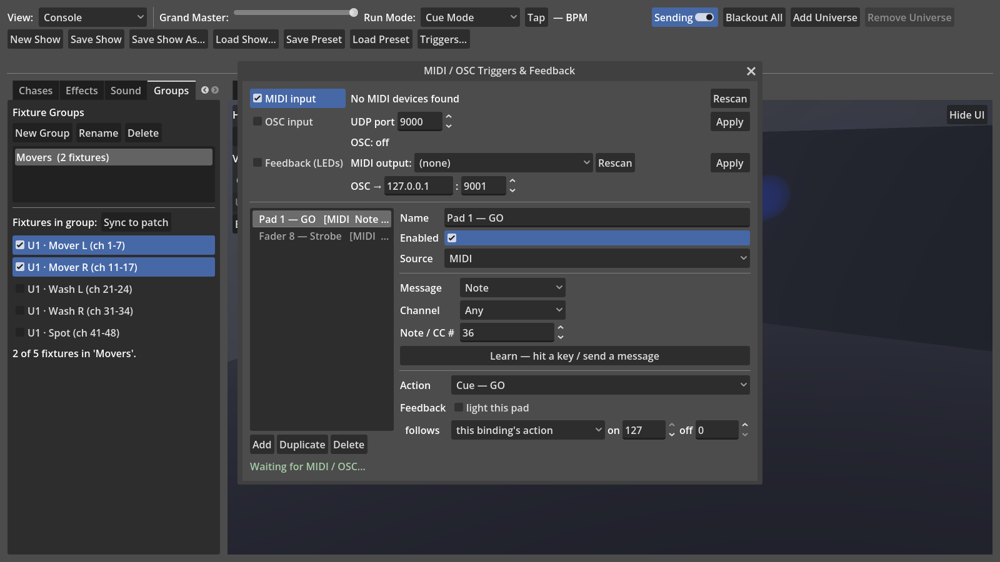

Turn on **MIDI input** or **OSC input**, click **Add**, then **Learn** and
play the pad / move the fader / send the message you want bound — the
match fields fill in automatically. Pick an **Action** (Cue GO, a chase or
effect toggle, blackout, …). **Feedback (LEDs)** can light a pad back
based on what it controls, or as a standalone beat/sending/run-mode
indicator. This is entirely optional — most of the app works fine with
just a mouse and keyboard.

MIDI feedback needs somewhere to send it: the screenshot above shows the
default **MIDI → bridge :** field, which needs a small helper script
running (`python tools/midi_bridge.py`, see the README). If the optional
`native` extension is built, this row becomes a **MIDI output** port
picker instead — pick a real MIDI port directly, no extra script needed.

## Saving your work

A show lives in one `.slight` file you choose, holding everything —
every universe's connection settings and patch, cues, chases, effects,
groups, named positions, sound reactors, MIDI/OSC bindings and the
visualizer's stage. The songs' lighting timelines go in a folder beside
it (`MyShow.slight` → `MyShow.timelines/`), so keep the two together
when you copy a show to another computer.

| Top bar | Keys | Does |
| --- | --- | --- |
| **Save Show** | **Ctrl+S** | Save to the current show file (asks where, for a new show) |
| **Save Show As…** | **Shift+Ctrl+S** | Save to a new file, copying the timelines folder alongside |
| **Load Show…** | **Ctrl+O** | Open a show |
| **New Show** | **Ctrl+N** | After asking, start an empty show (your output settings are kept) |

The show you last saved or loaded reopens automatically the next time
you start sLight. **Save/Load Preset** is a lighter-weight snapshot of
just the live DMX output, for a quick "go back to how it looked a minute
ago" without touching your cue list.

## Keyboard shortcuts

| Keys | Does |
| --- | --- |
| **Space** | GO the next cue (Console, Cue Mode) / play or pause the song (DJ Edit Mode) |
| **Ctrl+N / Ctrl+O** | New show / load a show |
| **Ctrl+S / Shift+Ctrl+S** | Save show / save show as |
| **Ctrl+Shift+N / Ctrl+Shift+R** | Add a universe / remove the current one |

DJ Edit Mode's timeline editing shortcuts are listed in Step 10.

## Where to go next

This guide covers the everyday path from an empty patch to a running
show. The [README](../README.md) is the complete reference — fixture
profile details (multi-mode personalities, 16-bit fine channels, named
value ranges for gobo/colour wheels), sACN and USB DMX output, cue
tracking vs. blocks, MVR import/export, every run mode's exact
behaviour, and exactly how DJ Perform Mode mixes decks and drives
strobe, position and movement channels are all there if you want to go
deeper.
